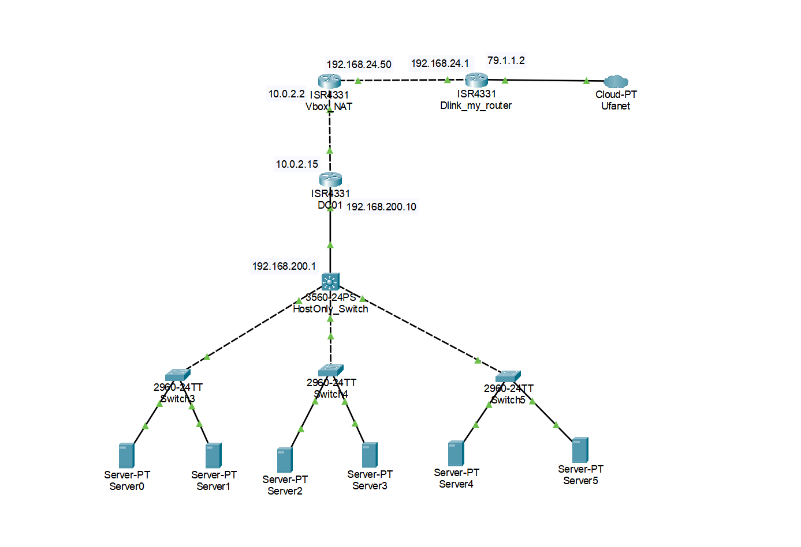

# Эмуляция виртуальной лаборатории VirtualBox в Cisco Packet Tracer

Данный репозиторий содержит конфигурации для эмуляции виртуальной лаборатории VirtualBox в симуляторе Cisco Packet Tracer. Стенд демонстрирует, как архитектура виртуальной лаборатории проецируется на сетевое оборудование Cisco. Основная задача стенда - показать принципы взаимодействия компонентов виртуальной инфраструктуры при переносе на физическое сетевое оборудование Cisco (маршрутизация, NAT, сегментация)



## Адресация

**Dlink_my_router (ISR4331)**
*   **WAN (Gi0/0/1):** 79.1.1.2/24, шлюз 79.1.1.1 (условно)
*   **LAN (Gi0/0/0):** 192.168.24.1/24

**Vbox_NAT (ISR4331)**
*   **WAN (Gi0/0/1):** 192.168.24.50/24, шлюз 192.168.24.1
*   **LAN (Gi0/0/0):** 10.0.2.2/24

**DC01 (ISR4331) - Шлюз, DHCP, DNS**
*   **WAN (Gi0/0/1):** 10.0.2.15/24, шлюз 10.0.2.2
*   **LAN (Gi0/0/0):** 192.168.200.10/24

**HostOnly_Switch (Multilayer Switch 3560)**
*   **VLAN 1:** 192.168.200.1/24, шлюз 192.168.200.10

**Клиенты (Server-PT)**
*   **Адрес:** Получают по DHCP из пула 192.168.200.30 - 254
*   **Шлюз и DNS:** 192.168.200.10

---

## Конфигурации устройств

### 1. Dlink_my_router (ISR4331)
*Эмуляция реального домашнего роутера. Выпускает трафик в интернет (Cloud-PT).*

```cisco
enable
configure terminal
no ip domain-lookup

! WAN (в сторону Ufanet)
interface GigabitEthernet0/0/1
 ip address 79.1.1.2 255.255.255.0
 ip nat outside
 no shutdown
 exit

! LAN (в сторону Vbox_NAT)
interface GigabitEthernet0/0/0
 ip address 192.168.24.1 255.255.255.0
 ip nat inside
 no shutdown
 exit

! NAT (PAT)
access-list 1 permit 192.168.24.0 0.0.0.255
ip nat inside source list 1 interface GigabitEthernet0/0/1 overload

! Маршрут по умолчанию в сторону провайдера
ip route 0.0.0.0 0.0.0.0 79.1.1.1

end
copy running-config startup-config
```

### 2. Vbox_NAT (ISR4331)
*Эмуляция встроенного NAT VirtualBox. Транслирует трафик из 10.0.2.0/24 в домашнюю сеть.*

```cisco
enable
configure terminal
no ip domain-lookup

! WAN (в сторону Dlink)
interface GigabitEthernet0/0/1
 ip address 192.168.24.50 255.255.255.0
 ip nat outside
 no shutdown
 exit

! LAN (в сторону DC01)
interface GigabitEthernet0/0/0
 ip address 10.0.2.2 255.255.255.0
 ip nat inside
 no shutdown
 exit

! NAT (PAT)
access-list 1 permit 10.0.2.0 0.0.0.255
ip nat inside source list 1 interface GigabitEthernet0/0/1 overload

! Маршрут по умолчанию
ip route 0.0.0.0 0.0.0.0 192.168.24.1

end
copy running-config startup-config
```

### 3. DC01 (ISR4331)
*Эмуляция Windows Server (RRAS, DHCP, DNS). Шлюз для всех виртуальных машин.*

```cisco
enable
configure terminal
no ip domain-lookup

! WAN (в сторону Vbox_NAT)
interface GigabitEthernet0/0/1
 ip address 10.0.2.15 255.255.255.0
 ip nat outside
 no shutdown
 exit

! LAN (в сторону HostOnly_Switch)
interface GigabitEthernet0/0/0
 ip address 192.168.200.10 255.255.255.0
 ip nat inside
 no shutdown
 exit

! NAT (PAT)
access-list 1 permit 192.168.200.0 0.0.0.255
ip nat inside source list 1 interface GigabitEthernet0/0/1 overload

! Маршрут по умолчанию
ip route 0.0.0.0 0.0.0.0 10.0.2.2

! Настройка DNS-сервера (эмуляция роли DNS в Windows Server)
ip dns server
! Настройка серверов пересылки (аналог Forwarders в Windows DNS)
ip name-server 1.1.1.1
ip name-server 8.8.8.8

! Настройка DHCP (исключаем адреса шлюза и коммутатора)
ip dhcp excluded-address 192.168.200.1 192.168.200.29
ip dhcp pool LAN_CLIENTS
 network 192.168.200.0 255.255.255.0
 default-router 192.168.200.10
 dns-server 192.168.200.10
 exit

end
copy running-config startup-config
```

### 4. HostOnly_Switch (Multilayer Switch 3560)
*Эмуляция виртуального адаптера физического ПК.*

```cisco
enable
configure terminal

! Отключаем маршрутизацию (чтобы не мешал DC01)
no ip routing

interface vlan 1
 ip address 192.168.200.1 255.255.255.0
 no shutdown
 exit

! Шлюз для самого коммутатора
ip default-gateway 192.168.200.10

end
copy running-config startup-config
```

### 5. Нижние коммутаторы (Switch3, Switch4, Switch5)
*Устройства 2960-24TT. Настройка не требуется, работают как L2-коммутаторы.*

---

## Инструкция по запуску и проверке

### Настройка клиентов (Server0 - Server5)
1. Кликните на любой `Server-PT` (например, `Server0`).
2. Перейдите в **Desktop** > **IP Configuration**.
3. Выберите **DHCP**.
4. Устройство должно получить адрес начиная с `192.168.200.30`, маску `255.255.255.0`, шлюз `192.168.200.10` и DNS `192.168.200.10`.
*(В дальнейшем для инфраструктурных сервисов, таких как Zabbix, Grafana и др., вы сможете настроить статические IP-адреса вручную через netplan внутри виртуальных машин).*

### Проверка связности (Ping и DNS)
С любого клиента (через Command Prompt) проверьте прохождение пакетов по всей цепочке:

```cmd
ping 192.168.200.10    # DC01 (шлюз)
ping 10.0.2.2          # Vbox_NAT
ping 192.168.24.1      # Dlink (Домашний роутер)
ping 79.1.1.2          # WAN (Интернет)

# Проверка работы DNS-сервера (эмуляция DC01)
ping google.com 
```
